# Before and after: the main screens

Left: before the usability work (the Round 1 audit, 18 November 2026, `content/wave-1-drafts` at 6e57e15). Right: after audit Rounds 1 to 3 and the bug bash (`fix/first-lesson-usability`, 22 November 2026). Same learner states where possible: brand new for the welcome, the first lesson for the lesson screens, three lessons in for the rest. The before set often shows a survey or a changed first lesson; those were among the problems fixed. Phone 390 × 844, laptop 1366 × 768, Chrome. The full sets of raw screenshots stay out of git; `docs/usability/README.md` says where they are.

## Phone

**welcome**

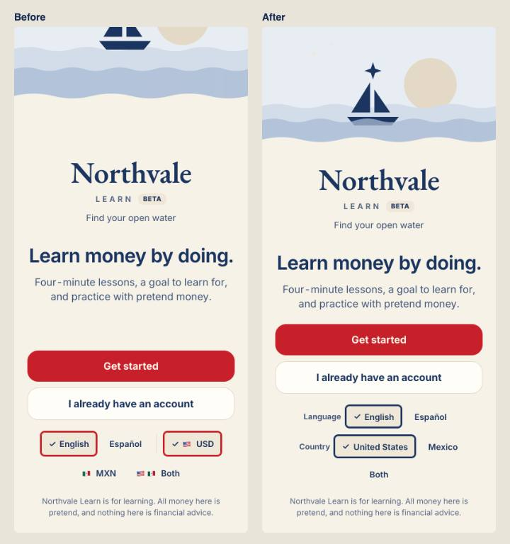

**lesson card**

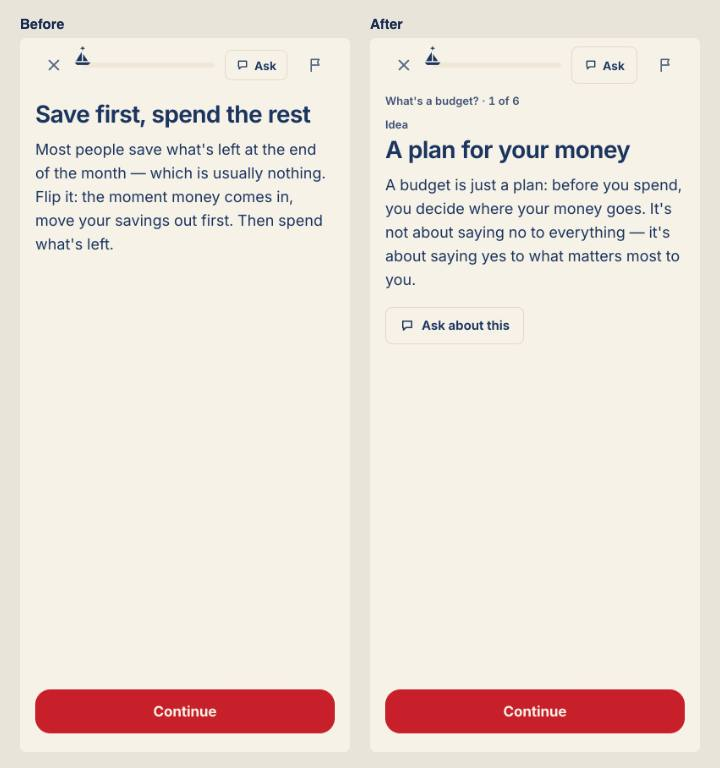

**question answered**

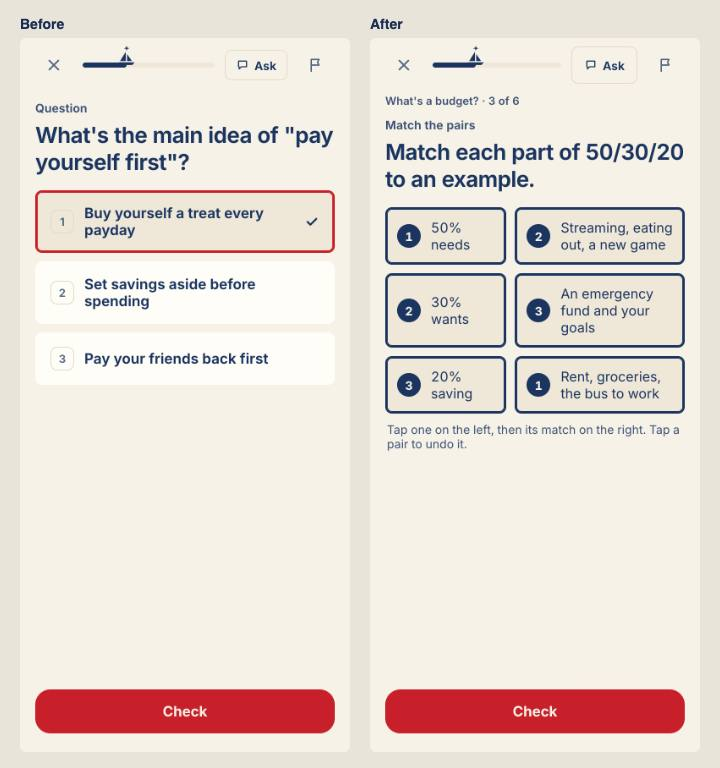

**feedback**

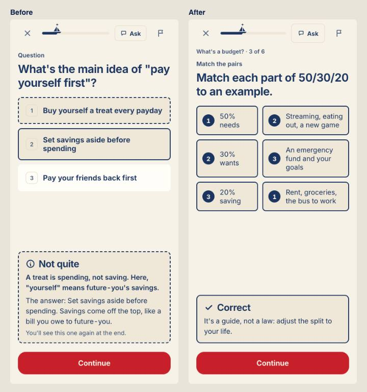

**lesson complete**

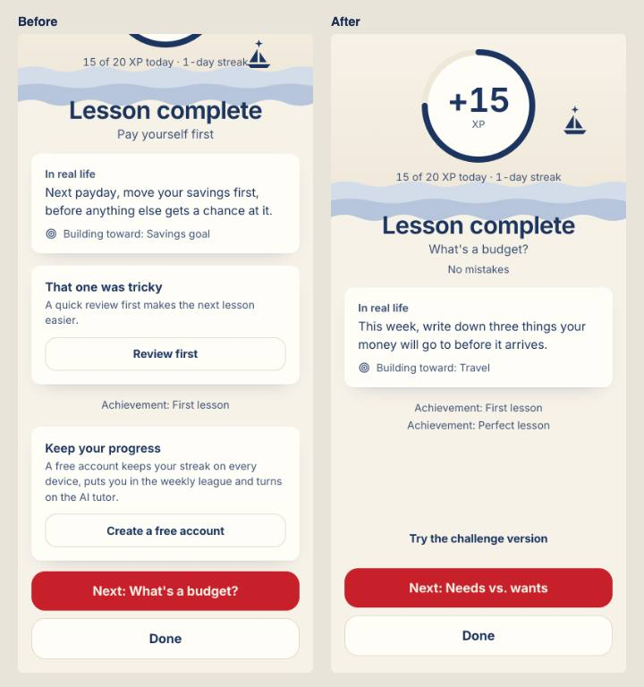

**today**

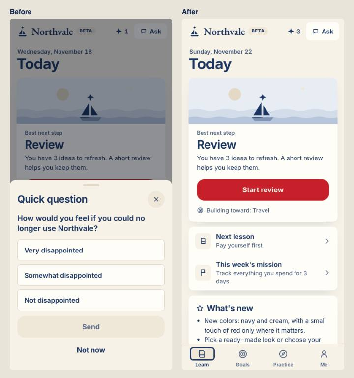

**goals**

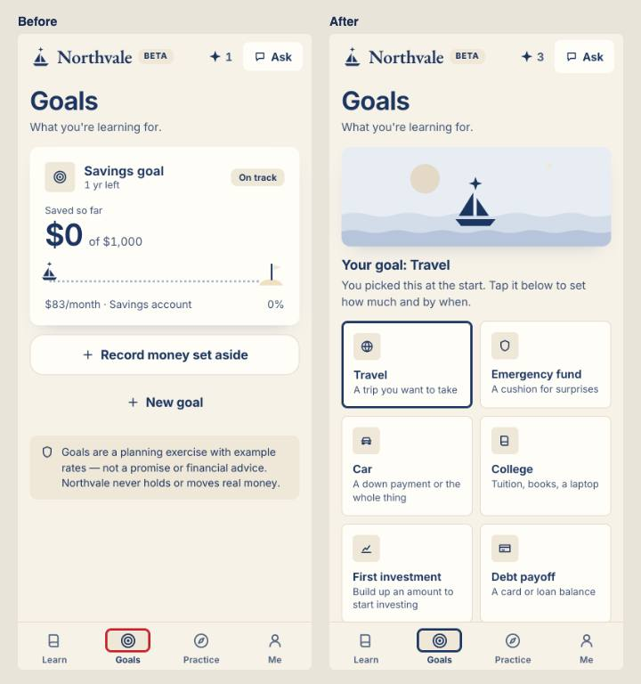

**practice**

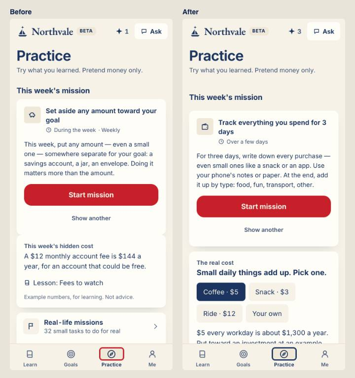

**me**

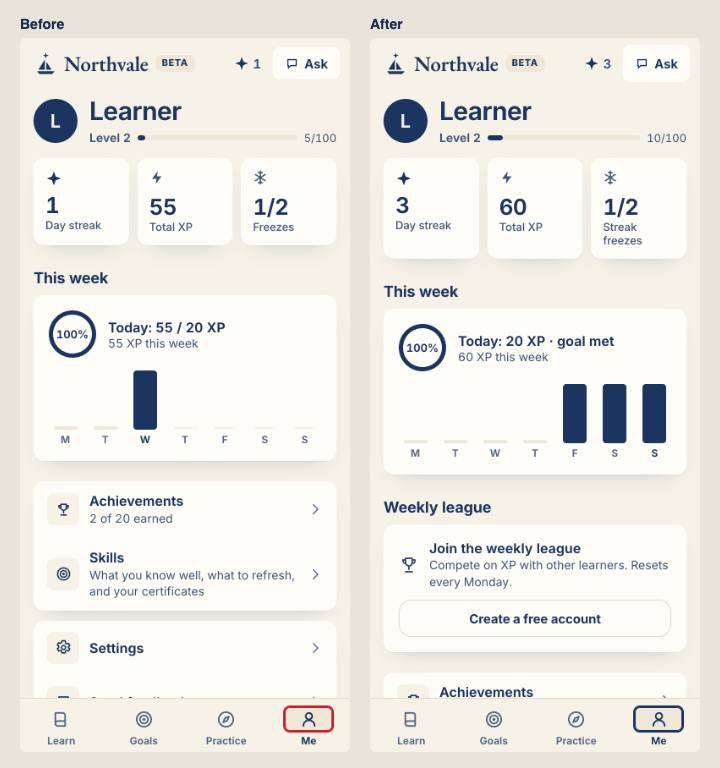

**settings**

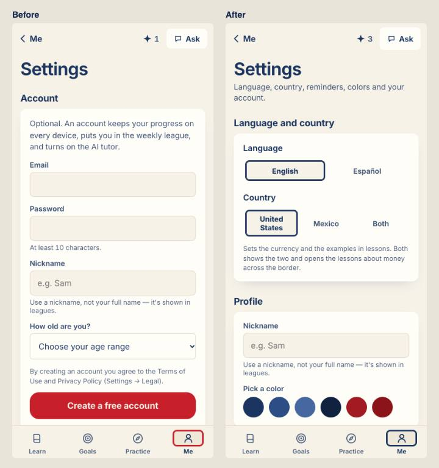

## Laptop

**welcome**

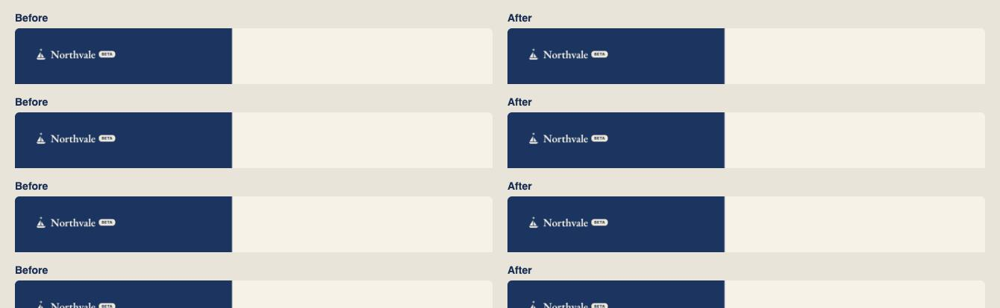

**lesson card**

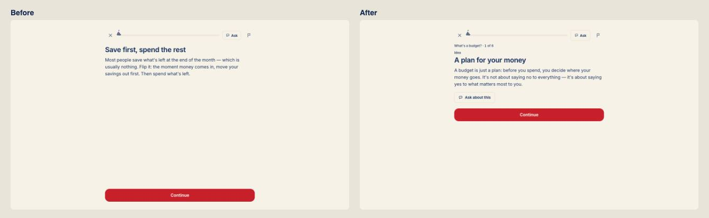

**question answered**

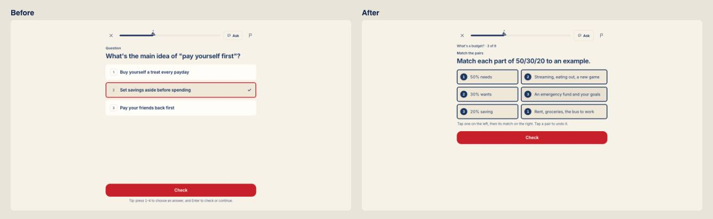

**feedback**

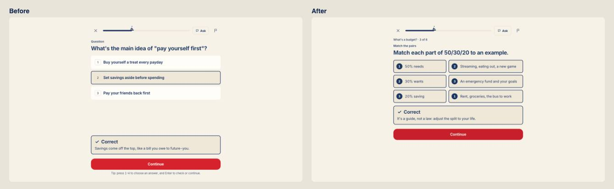

**lesson complete**

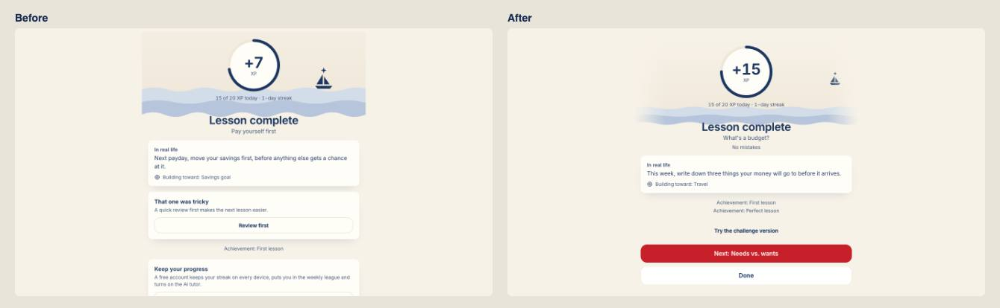

**today**

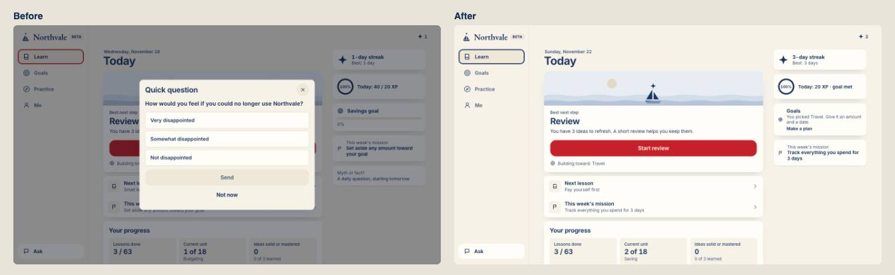

**goals**

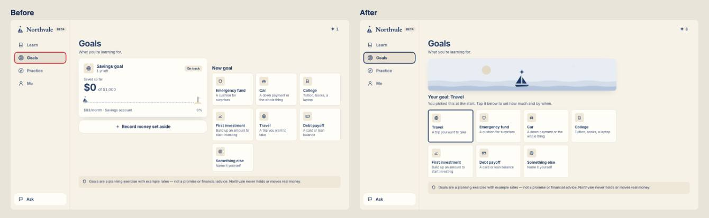

**practice**

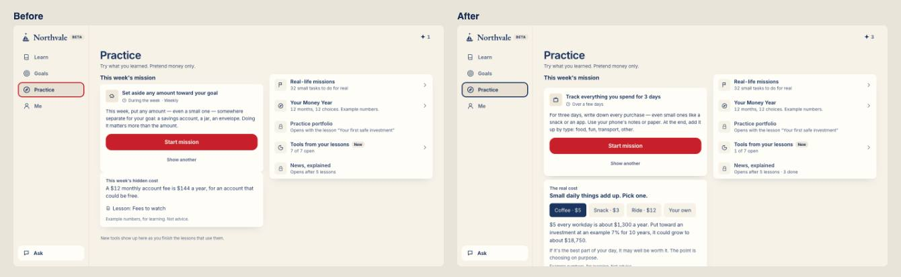

**me**

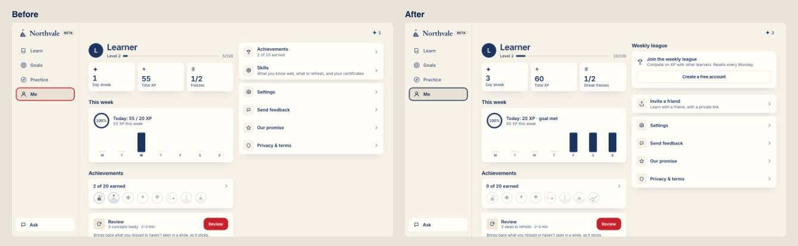

**settings**

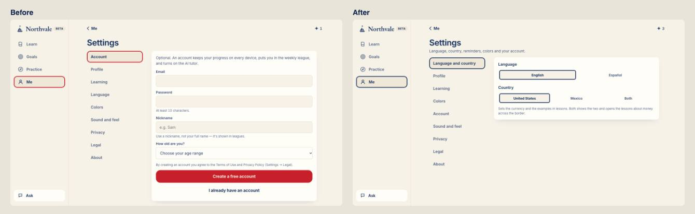

